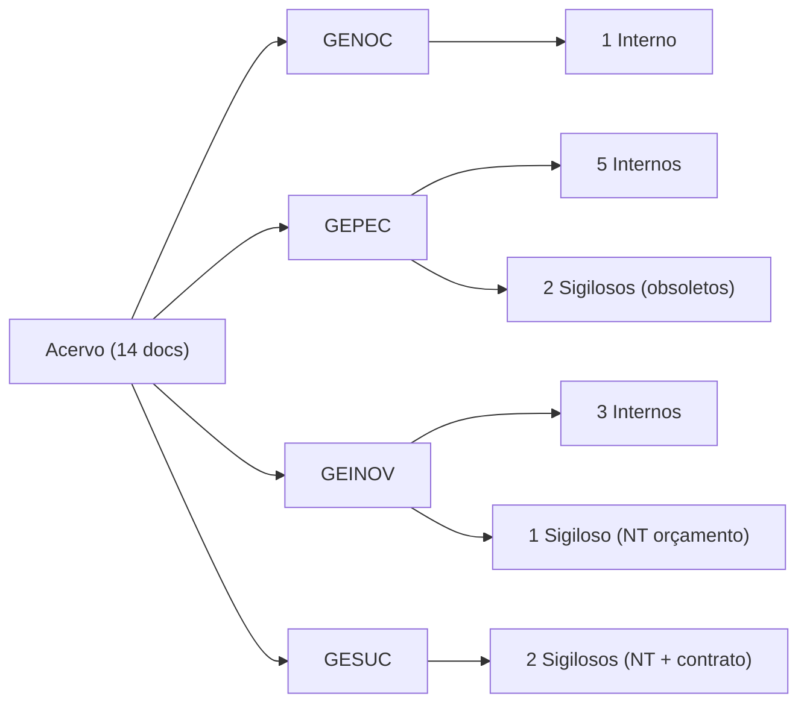

# Classificação dos documentos: acervo ACME (fictício), contexto BBTS

Analisei os **14 PDFs** de `documentos_desafio_2`. Eles formam três "famílias" de assunto e um catálogo geral.

> [!NOTE]
> **Todos** os documentos trazem a etiqueta `#interna` no cabeçalho. A classificação abaixo é a **minha análise pelo conteúdo** (quem *precisa* saber). Quando ela diverge da etiqueta, explico o motivo.

## 1. Departamentos fantasia (contexto bancário: BBTS)

Os nomes seguem o padrão de gerências de uma instituição financeira e do conglomerado BB, com siglas fictícias.

| Departamento fantasia | Unidade no acervo ACME | Missão no contexto bancário |
|---|---|---|
| 👥 **Gestão de Pessoas e Carreira (GEPEC)** | GGC: Gerência de Gente e Cultura | Férias, jornada, benefícios e folha dos funcionários |
| 💡 **Inovação e Transformação Digital (GEINOV)** | NIN: Núcleo de Inovação (aprovação DIRTEC) | Ideias, protótipos e MVPs de soluções e serviços digitais |
| 📑 **Suprimentos e Contratações (GESUC)** | GCO: Gerência de Compras e Contratos (aprovação DIRAF) | Contratações, cotações e gestão de contratos com fornecedores |
| 🏛️ **Governança Normativa e Compliance Documental (GENOC)** | Arquivo Central de Normas (NG_010) | Normativos internos, taxonomia, versionamento e conformidade do acervo |

## 2. Critério usado

- **🌐 INTERNO (empresa toda):** o documento orienta ou é usado por qualquer empregado (regras, passo a passo, formulários em branco, regulamentos de programas abertos).
- **🔒 SIGILOSO (do departamento):** traz dados financeiros, comerciais ou de terceiros (preços, cotações de fornecedores, multas, alçadas e orçamento), ou é uma versão obsoleta que não pode circular para não causar uso errado.

## 3. Classificação documento a documento

### 🏛️ GENOC: Governança Normativa e Compliance Documental
| Documento | Contexto / função / intenção | Classificação |
|---|---|---|
| Instruções sobre o acervo (Catálogo v0.1.0) | Explica as 12 categorias (NG, PX, FM…), a numeração, as séries e a vigência. Serve para que qualquer pessoa saiba ler e localizar normas. | 🌐 **INTERNO** |

### 👥 GEPEC: Gestão de Pessoas e Carreira (Férias)
| Documento | Contexto / função / intenção | Classificação |
|---|---|---|
| NG_111 v3.0.0: Férias | Norma-mãe: programação anual, 45 dias de antecedência, fracionamento, abono, 13º, limite de 30% da equipe. Vale para todos os empregados. | 🌐 **INTERNO** |
| PX_1111-001: Procedimento de Férias | Passo a passo de cada ator (empregado, gestor, diretor, GGC, GFI). | 🌐 **INTERNO** |
| FM_1111-001 v2.0.0: Solicitação de Férias | Modelo de formulário do Portal Raiz que todo empregado preenche. | 🌐 **INTERNO** ⚠️ |
| TB_1111-001: Tabelas de Férias | Faltas × dias, quadro de prazos, calendário e limite de ausência. | 🌐 **INTERNO** |
| FL_1111-001: Fluxograma de Férias | Representação gráfica do processo. | 🌐 **INTERNO** |
| *substituídos/* NG_111 v2.0.0 | Versão anterior da norma, já substituída pela v3.0.0. | 🔒 **SIGILOSO**: arquivo histórico da GEPEC |
| *substituídos/* FM_1111-001 v1.0.0 | Formulário antigo (antecedência de 30 dias, hoje são 45). | 🔒 **SIGILOSO**: arquivo histórico da GEPEC |

> ⚠️ O **modelo** em branco do FM é interno. Um formulário **preenchido** (nome, matrícula, datas, abono, 13º) contém dados pessoais e passa a ser 🔒 sigiloso da GEPEC.

### 💡 GEINOV: Inovação e Transformação Digital
| Documento | Contexto / função / intenção | Classificação |
|---|---|---|
| NG_1130: Gestão da Inovação | Princípios, Portal de Ideias, funil de 5 etapas, Comitê de Inovação, direitos sobre as soluções. | 🌐 **INTERNO** |
| PX_1130-001: Funil de Inovação | Prazos de cada etapa do funil, campanhas, imersão, indicadores e incentivo fiscal. Os proponentes precisam conhecê-lo. | 🌐 **INTERNO** |
| RG_1100 v2.0.0: Programa Ideias em Campo | Regulamento de um programa aberto a todos: fases, votação interna, arenas e prêmios. | 🌐 **INTERNO** |
| NT_2026-021: Orçamento e competências (2027) | Justifica o orçamento de R\$ 96 mil, a divisão por item, as alçadas de gasto (NIN/DIRTEC/Comitê) e os dados da edição anterior. Documento de decisão gerencial. | 🔒 **SIGILOSO**: GEINOV (+ DIRTEC/DIRAF) |

### 📑 GESUC: Suprimentos e Contratações (Locação de coworking)
| Documento | Contexto / função / intenção | Classificação |
|---|---|---|
| NT_2026-018: Contratação de coworking | Justifica a contratação para a equipe da GOC em Vale Azul. Traz **cotações de 3 fornecedores**, o preço de referência, a verificação de fracionamento e a alçada. | 🔒 **SIGILOSO**: GESUC (+ GOC e DIRAF) |
| CTR_2026-012: Contrato de locação | Acordo com o Hub Jacarandá: valores, multas, rescisão, dados pessoais dos usuários e foro. | 🔒 **SIGILOSO**: GESUC (+ GOC como fiscal e GFI para pagamento) |

## 4. Resumo

| Classificação | Qtd | Documentos |
|---|---|---|
| 🌐 Interno | 9 | Catálogo, NG_111 v3, PX_1111-001, FM_1111-001 v2, TB_1111-001, FL_1111-001, NG_1130, PX_1130-001, RG_1100 v2 |
| 🔒 Sigiloso | 5 | NG_111 v2 e FM v1 (substituídos), NT_2026-021, NT_2026-018, CTR_2026-012 |

## 5. Decisão: sigilo mantido apesar da etiqueta `#interna`

> [!IMPORTANT]
> **Decisão confirmada:** os itens abaixo ficam **🔒 SIGILOSOS**, mesmo marcados como `#interna`.
> - **NT_2026-018 e CTR_2026-012 (GESUC):** a NT declara "Uso interno" na seção 6, mas expõe preços de concorrentes, condições negociadas e dados pessoais de usuários. Acesso restrito à GESUC, à unidade demandante e à área de pagamento.
> - **NT_2026-021 (GEINOV):** traz orçamento, alçadas de aprovação e indicadores da edição anterior. Acesso restrito à GEINOV e às diretorias aprovadoras.
> - **Versões substituídas (GEPEC):** regras antigas em circulação (ex.: 30 dias de antecedência) podem levar a erro. Ficam só no arquivo histórico da GEPEC, para auditoria.
