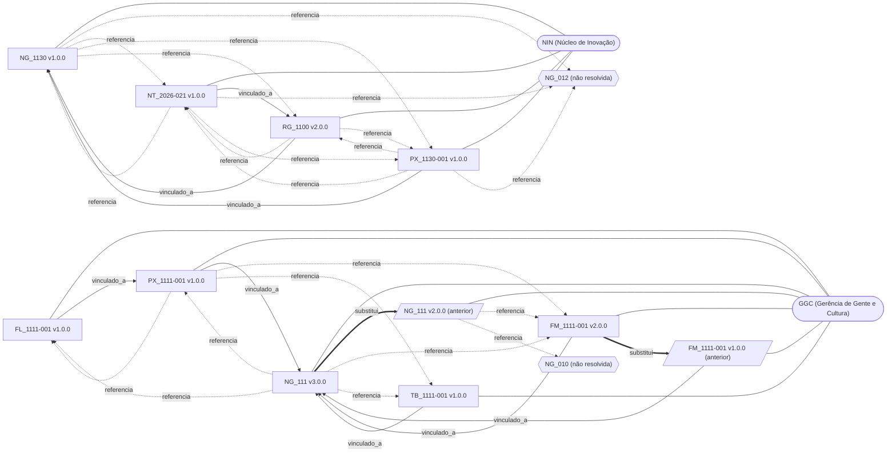

# Metodologia: relações do acervo (grafo)

Este documento explica como as relações entre os documentos do acervo são montadas e para onde
elas vão. Ele também registra o caminho que os dados percorrem antes, porque é o mesmo caminho
que alimenta o chat.

- Código: `app/services/grafo.py`. Testes: `tests/test_grafo.py`.
- Destino: o espelho no Neon (`app/services/persistencia.py`, tabela `relacoes`), com o nível do
  documento de origem em cada linha.
- Revisão de segurança feita antes do código: `docs/SEGURANCA_GRAFO_CODEX.md`.

> **Histórico.** Até o commit `3ddaeda` havia a rota `GET /grafo`, com uma projeção por nível de
> acesso e um gerador de diagrama Mermaid. O hacka-front não tem tela de mapa do acervo, então a
> rota, a projeção e o gerador saíram (ver `docs/HISTORICO_COMMITS.md`). As seções 4, 6 e 7
> registram como era, para quem quiser trazer a tela de volta.

## O que o grafo é, e o que ele não é

O grafo liga os documentos do acervo, as versões de cada um e as relações entre eles: quem
substitui quem, quem está vinculado a quem e quem cita quem.

- **É só leitura.** Ele lê o mesmo Silver que o chat já usa. Nada novo é extraído dos PDFs.
- **Não muda o chat.** O índice BM25, o roteador de custo e as respostas continuam iguais. O chat
  não consulta o grafo e não busca trechos "por vizinhança".
- **Não sai para o cliente.** Nenhuma rota da API devolve as relações. Elas vão só para o banco,
  onde cada linha leva o nível do documento de origem.
- **Não concede acesso.** Uma relação nunca abre um documento nem muda o nível dele.
- **Não usa LLM.** A construção é determinística: mesma entrada, mesmas relações. Isso torna o
  resultado auditável, sem custo por chamada e imune a instruções escondidas no texto dos PDFs.

## 1. Origem dos dados (pipeline Bronze → Silver)

O grafo parte do acervo já ingerido. A ingestão (`app/services/ingest/pipeline.py`) segue estes
passos:

1. **Manifesto (Bronze).** `app/seed/manifesto.json` lista cada PDF com código, versão, arquivo,
   `sha256`, tema, domínio dono, classificação mínima e vigência. É gerado por
   `scripts/gerar_manifesto.py`. PDF fora do manifesto, ou com hash diferente, vai para quarentena
   e não entra em nada.
2. **Extração.** O texto sai do PDF com `pypdf`, com limites de 20 MiB, 200 páginas e 2.000
   trechos por arquivo.
3. **Cabeçalho.** `app/services/ingest/header.py` lê código, versão, tipo, título, fase,
   classificação, elaborado/aprovado por, vigência e o campo "Vinculado a" (ou "Referência").
4. **Fatiamento.** O texto vira um trecho por item numerado (ex.: `4.3.2`), cláusula, anexo,
   apêndice, tabela ou exemplo. Cada trecho carrega código, versão, item, nível, vigência, tema e
   domínio do documento.
5. **Nível efetivo.** Vale o maior entre a classificação do manifesto e a do cabeçalho. A marca
   do PDF nunca rebaixa o manifesto.
6. **Cache Silver.** O resultado fica em `data/silver.json` (fora do Git). Só é refeito quando
   muda o hash do manifesto ou a versão do parser.

Hoje o acervo sintético tem **14 documentos** e **497 trechos**: 13 PDFs e 1 documento virtual
(`DOSSIE_GGC_FOLHA`), criado para a demonstração de pedido de acesso.

### Como o chat usa esse mesmo Silver (registro, sem mudança)

Para quem precisar explicar a busca do chat, este é o desenho atual:

1. **Partição por nível.** Há um índice BM25 por nível de acesso. O índice de cada nível só
   contém trechos que aquele nível pode ver. O filtro acontece antes da busca, então o LLM nunca
   recebe trecho proibido.
2. **Portão de relevância.** Um trecho só conta se tiver pelo menos 2 termos em comum com a
   pergunta, ou se cobrir pelo menos metade dos termos dela. Isso evita citar documento que não
   tem relação com a pergunta.
3. **Versões substituídas** ficam fora da busca comum. Elas só entram quando a pergunta compara
   versões.
4. **Roteador de custo**, nesta ordem: lacuna conhecida (abstenção honesta) → calculadora
   determinística → alerta de regra revogada → busca + LLM. A resposta do LLM só é aceita se citar
   os trechos enviados. Sem LLM, ou sem citação válida, o chat devolve os trechos (modo
   extrativo).

## 2. Modelo das relações

Cada relação é uma linha `{origem, alvo, tipo, itens, nivel}`:

- `origem`: a versão exata do documento que cita, no formato `CODIGO@VERSAO`
  (ex.: `NG_111@3.0.0`). Cada versão conta à parte: duas versões do mesmo código nunca se fundem.
- `alvo`: o código citado (ex.: `NG_012`), ou a versão exata quando a relação é entre versões.
- `nivel`: o nível do documento de origem. Quem lê o banco filtra por ele.

| Tipo | Direção | Evidência | Regra |
|---|---|---|---|
| `substitui` | versão vigente → versão anterior | Manifesto e cabeçalho (`fase`, `vigente`) | Só existe se o código tiver exatamente uma versão vigente |
| `vinculado_a` | documento → código citado | Campo "Vinculado a"/"Referência" do cabeçalho | Declarado pelo autor do documento |
| `referencia` | documento → código citado | Código encontrado no texto de um trecho | Menção detectada. Guarda os itens onde aparece |

Toda relação guarda em `itens` onde está a evidência: `cabeçalho` ou os itens do documento de
origem (ex.: `["2.3", "4.3.1", "Anexo E"]`). Quem lê consegue voltar ao PDF e conferir.

## 3. Passo a passo da construção

A construção roda uma vez, no startup da API (`Grafo._montar`), sobre o acervo completo. O
resultado fica na memória do servidor e vai para o banco em segundo plano
(`persistencia.sincronizar_em_segundo_plano`). Nenhuma rota o devolve.

1. **Indexar as versões.** Cada documento ganha o id `CODIGO@VERSAO`.
2. **Ligar as versões (`substitui`).** Os documentos são agrupados por código. Se houver
   exatamente uma versão vigente, ela aponta para cada versão não vigente de número menor.
   Se houver zero ou duas vigentes, nenhuma aresta é criada: o grafo não inventa sucessão.
3. **Ler os vínculos declarados (`vinculado_a`).** O campo do cabeçalho só vira relação se casar
   inteiro com a gramática de código (passo 4) e não apontar para o próprio documento.
4. **Detectar menções (`referencia`).** Cada trecho, exceto o cabeçalho, passa por uma expressão
   regular de gramática fechada:

   ```
   \b(?:NG|PX|PP|GU|FM|TB|FL|RG|NT|CTR|DV)_\d{3,4}(?:-\d{3})?\b
   ```

   - Só vira menção um código completo: prefixo conhecido, 3 ou 4 dígitos e sufixo opcional `-000`.
     `XNG_123`, `NG_12` e `NG_1234567` são ignorados.
   - Códigos repetidos no mesmo trecho contam uma vez. No máximo 30 códigos por trecho.
   - Citar o próprio código não gera relação.
   - As menções são somadas por par (origem, código), com até 8 itens de proveniência por relação.
   - Se o mesmo par já existe como `vinculado_a`, a menção é descartada: o vínculo declarado
     no cabeçalho prevalece.
5. **Limite.** Acima de 5.000 relações, o startup falha. Nada é cortado em silêncio.

## 4. Projeção por nível (removida com a rota `/grafo`)

Enquanto existiu a rota, `Grafo.projetar(nivel, tema)` montava a visão de um nível a partir do
grafo completo. A regra vale para qualquer tela que volte a mostrar as relações:

1. **Documentos visíveis.** Entram só as versões que o nível pode ver (e do tema pedido, se houver).
2. **Áreas.** Uma área só aparece se houver documento visível dela. Ana não descobre que a GCO
   existe só porque ela é dona de um contrato Restrito.
3. **Evidência visível.** Uma aresta só entra se o documento de origem for visível. O que um
   documento Restrito cita nunca aparece para quem não o lê.
4. **Resolução do código citado.** O código vira um nó `documento` se a sua versão vigente for
   visível, em qualquer tema.
5. **Alvo invisível = alvo inexistente.** Se o código citado não existe no acervo, ou existe mas o
   nível não pode vê-lo, o resultado é o mesmo nó neutro `ref:CODIGO`. Esse nó só tem o código,
   que a pessoa já leu no documento de origem. Sem título, nível ou área.
6. **Sucessão.** A aresta `substitui` só aparece se as duas versões forem visíveis.

Projeções do acervo sintético quando a rota existia:

| Nível | Documentos | Áreas | Referências não resolvidas | Arestas |
|---|---|---|---|---|
| Pública | 0 | 0 | 0 | 0 |
| Interna | 11 | 2 | 2 (`NG_010`, `NG_012`) | 42 |
| Restrita | 14 | 3 | 2 | 49 |
| Sigilosa | 14 | 3 | 2 | 49 |

`NG_010` e `NG_012` são citados pelas normas, mas não estão no acervo recebido. O auditor
(`GET /audit/findings`) os aponta como "Documento Referenciado Ausente".

## 5. Decisões e limites conhecidos

- **Uma referência por código aponta para a versão vigente.** Os PDFs citam só o código, sem
  versão. Por isso a `NG_111 v2.0.0` (anterior) aparece citando o `FM_1111-001 v2.0.0`
  (vigente). Ligar à versão da época exigiria datas de vigência confiáveis em todos os documentos.
- **`referencia` é menção, não dependência.** O grafo diz "o código aparece no item X". Ele não
  afirma que uma norma obriga a outra.
- **Citação sem código não é detectada.** Um texto como "conforme a norma de férias" não vira
  aresta.
- **Reclassificar exige reiniciar a API.** Acervo, índice e grafo ficam em cache no processo e
  são recarregados juntos. Trocar o manifesto sem reiniciar mantém a política anterior.
- **O banco guarda o grafo completo.** Por isso cada relação leva o `nivel` da origem, e a leitura
  do banco precisa filtrar por ele (LGPD art. 46). O papel da aplicação não lê essa tabela por
  rota nenhuma.
- **O Silver não é assinado contra edição local.** Quem consegue editar `data/` já administra o
  servidor. Essa é a mesma premissa do resto do back.

## 6. Como usar

Ver as relações de um documento, direto do código:

```python
from app.services.grafo import get_grafo
for r in get_grafo().relacoes():
    if r["origem"] == "NG_111@3.0.0":
        print(r["tipo"], r["alvo"], r["itens"])
```

A saída contém relações de todos os níveis. Não cole em issue, PR ou log: use só no servidor.

## 7. Mapa do acervo, projeção Interna

Gerado em 12/11/2026 com a projeção que existia (seção 4), sobre o acervo **sintético** da ACME.
O nível Interna foi escolhido de propósito. **Nunca commite projeção Restrita ou Sigilosa:** um
arquivo no Git contorna o controle de acesso, e apagar depois não remove a cópia do histórico.

Legenda: retângulo = versão vigente; paralelogramo = versão anterior; pílula = área dona;
hexágono = código citado que não se resolve; `==>` substitui; `-->` vinculado_a;
`-.->` referencia; `---` pertence_a.



O que o mapa mostra:

- **Férias (GGC):** a `NG_111 v3.0.0` é o centro. Formulário, procedimento, tabela e fluxo estão
  vinculados a ela. Ela substitui a v2.0.0, que é a única a citar a `NG_010`.
- **Inovação (NIN):** `NG_1130`, `PX_1130-001`, `RG_1100` e `NT_2026-021` se citam em ciclo. Três
  delas citam a `NG_012`, que não está no acervo. É a lacuna que o chat responde com abstenção
  honesta.

## 8. Segurança: onde cada achado do Codex foi tratado

| Achado | Tratamento |
|---|---|
| GRAFO-01, 02, 03 (nó ausente, proveniência e contagens revelam documento oculto) | Nenhuma rota devolve as relações; no banco, cada linha leva o nível da origem |
| GRAFO-04 (autorizar pela versão exata) | Cada versão é um nó; `substitui` exige as duas versões visíveis |
| GRAFO-05 (expansão de busca por vizinho) | **Não se aplica.** O chat não usa o grafo; a busca não foi alterada |
| GRAFO-06 (versão antiga volta à resposta normativa) | O grafo só mostra a sucessão. A busca comum continua sem versões substituídas |
| GRAFO-07 (sucessão ambígua) | Sem aresta quando o código não tem exatamente uma versão vigente |
| GRAFO-08, 09 (aresta muda acesso; código forjado) | Nenhuma aresta altera nível, dono ou vigência; gramática fechada de código |
| GRAFO-12 (cache) | Sem projeção nem cache por pessoa: o grafo único fica só no servidor |
| GRAFO-13, 14 (injeção no Mermaid) | O gerador saiu; o diagrama da seção 7 é texto fixo, revisado |
| GRAFO-15, 16 (limites) | 30 códigos por trecho, 8 itens por relação, 5.000 relações; sem rota pública |
| GRAFO-17 (tema livre) | Sem rota, sem parâmetro |
| GRAFO-19 (diagrama no Git) | Só a projeção Interna do acervo sintético está neste arquivo |
| GRAFO-20 (`AUTH_MODE` digitado errado) | Valor fora de `demo`/`token` impede a API de subir |
| GRAFO-21 (chat revela área de conteúdo Restrito) | Exceção declarada em `docs/CONTRATO.md`. As relações não repetem esse comportamento |

Achados que dependem de decisões fora deste escopo (Silver assinado, recarga de política sem
reiniciar, cache do front) estão registrados no relatório do Codex e na seção 5.

O acervo é sintético ("A ACME Tecnologia e Serviços é uma empresa fictícia"). Com `AUTH_MODE=demo`
qualquer pessoa escolhe qualquer persona. Por isso o back só deve rodar com dados reais em
`AUTH_MODE=token`, atrás de HTTPS.
